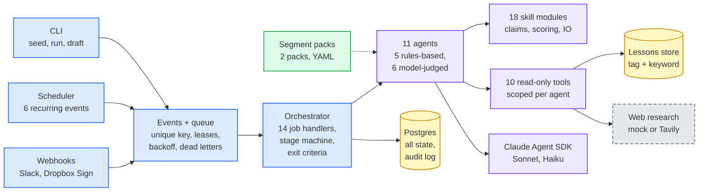
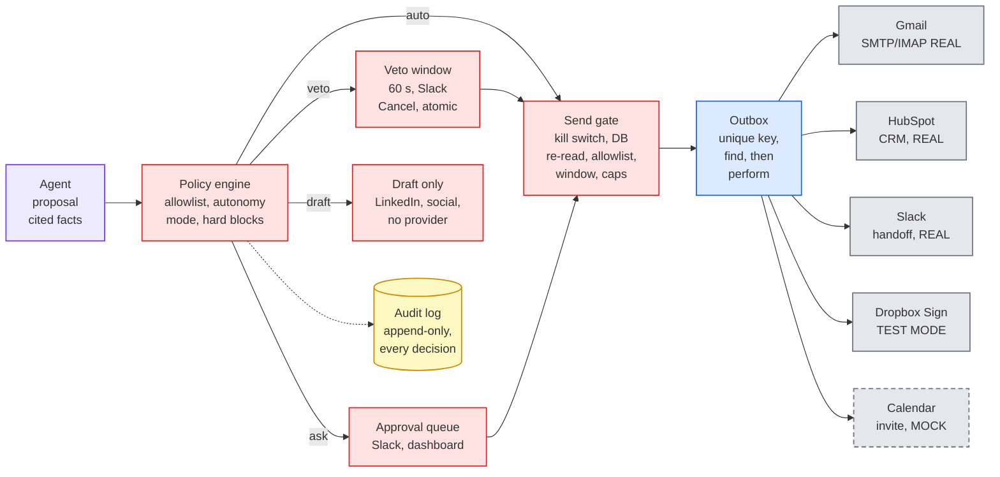
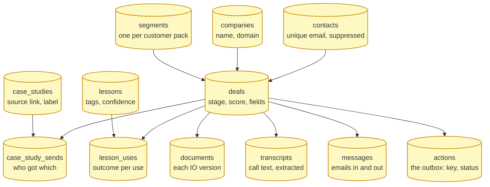
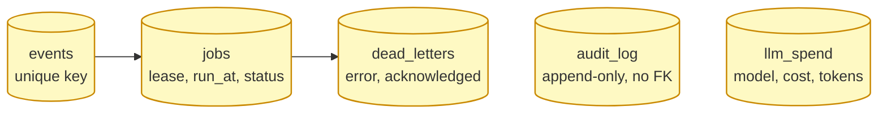
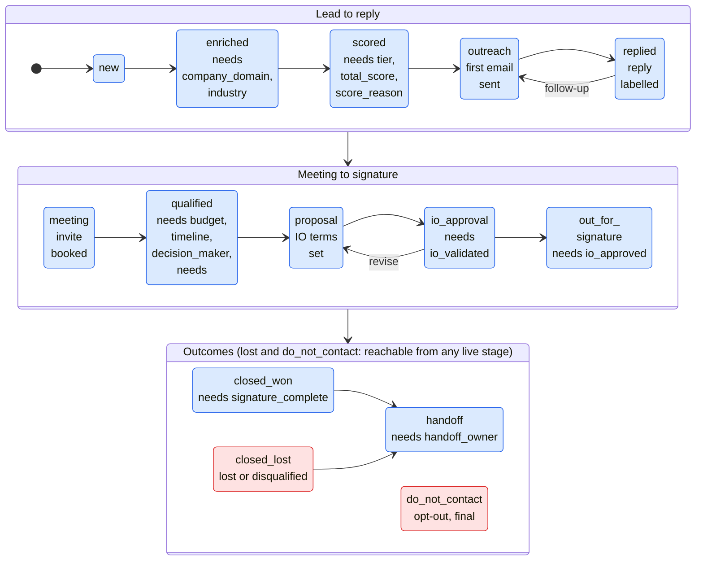

# Agentic Revenue System: Design

AI agents run the revenue lifecycle (prospect to handoff) for an ad-tech company: HubSpot is the CRM, Postgres the source of truth, the Claude Agent SDK (Python 3.12) the agent runtime. Every diagram box is traced to a file and a test in `docs/architecture-evidence.md`.

```mermaid
%% id=legend
flowchart LR
  L1["Events"]:::event ~~~ L2["Agents, model"]:::agent ~~~ L3["Config"]:::config ~~~ L4["Policy"]:::policy ~~~ L5["Storage"]:::store ~~~ L6["External"]:::ext ~~~ L7["Dashed = MOCK"]:::mock
  classDef event fill:#dbeafe,stroke:#2563eb,stroke-width:1.5px;
  classDef agent fill:#ede9fe,stroke:#7c3aed,stroke-width:1.5px;
  classDef config fill:#dcfce7,stroke:#16a34a,stroke-width:1.5px;
  classDef policy fill:#fee2e2,stroke:#dc2626,stroke-width:1.5px;
  classDef store fill:#fef9c3,stroke:#ca8a04,stroke-width:1.5px;
  classDef ext fill:#e5e7eb,stroke:#6b7280,stroke-width:1.5px;
  classDef mock fill:#ffffff,stroke:#6b7280,stroke-width:1.5px,stroke-dasharray:6 4;
```

## 1. Problem and goals

The risky parts of selling (a wrong claim, a mail to the wrong person, an unapproved discount) are what a model guarantees worst. Goals: run the lifecycle with a person only where policy says so; make every side effect idempotent, auditable and stoppable; add a segment by configuration, never code; run fully offline for tests and for real in the demo, and say which is which.

## 2. Architecture

**The model proposes, code decides.** Agents return typed proposals; only the orchestrator turns them into actions, through the policy engine, the send gate and the stage machine. Agents have no built-in SDK tools and load no host settings, only their own scoped read-only tools, and an unresolvable scope blocks the call (fail closed).

**Fig 1a: an event becomes a decision.** A trigger writes an `events` row (unique key) and one job; a worker claims it under a lease and the orchestrator runs one recorded, replayable agent step. Offline, a rules runner and fake model replace Claude.

**Fig 1b: a decision becomes a side effect.** `auto_with_veto` waits 60 s with a Slack Cancel button, `needs_approval` waits for a person, draft-only types have no provider. The gate re-reads state from the database; the outbox asks the provider before any retry.

## 3. Autonomy and guardrails

| Guardrail | How it works (file) |
|---|---|
| Allowlist policy | Action types come from the pack's `autonomy_levels`; unknown types are denied. Hard blocks never send: failed claim check, injection flag, suppression, discount over the maximum, invalid IO (`policy/engine.py`) |
| Autonomy, veto, kill switch | `autonomous` or `approval` mode (a `system_settings` row read on every decision); tier A first touches wait 60 s and Cancel is a compare-and-set, so cancel at second 59 and send at second 60 cannot both win; the kill switch holds outbound actions and re-queues them once on release (`policy/settings.py`) |
| Send gate | Re-reads approval, contact and suppression from the database; demo recipient allowlist, recipient-local send window, atomic daily and per-domain caps (`policy/gate.py`) |
| Untrusted content | Replies, pages and transcripts are wrapped, scanned (hidden HTML too), quarantined, never obeyed (`domain/injection.py`); a web result is kept only if its domain, name and known location match the lead (`skills/entity_match.py`) |
| Claim checker | Code rejects any undeclared number, name or date, then a model verifier checks each cited fact; no verifier fails closed; a company's own superlative (top, best, leading) must be attributed to it; a failed line is replaced by the pack's wording (`skills/claims.py`) |
| Audit | `audit_log` is append-only (trigger), written in the same transaction as the change, one correlation id per event |

## 4. Reliability

Postgres is the only queue and state. **Events** have a unique key (a duplicate is a no-op). **Jobs** are claimed with `FOR UPDATE SKIP LOCKED` under a 60 s lease (a crashed worker's job is reclaimed), retried with jittered exponential backoff (5 s base, 1 h cap, 5 attempts), then moved to **dead letters** an operator can retry or acknowledge. Action keys are `deal:step:index`, so a re-run adds nothing. **Outbox**: every side effect is an `actions` row; `execute_action` locks it, asks the provider (`find` by message id, CRM record or envelope id) and only then performs, so a crash after the provider accepted never double-sends. **Timers** are jobs with a future `run_at` (veto expiry, snooze end, send window); six recurring events use time-bucket keys so two schedulers cannot duplicate a tick.

## 5. Data model and state transitions

A deal's stage changes only through `transition_deal()` (a trigger refuses any other update): it checks the allowed moves and the pack's exit criteria and writes the audit row in the same transaction (Fig 2). The tables follow in Fig 3.

**Fig 3: data model (migrations 0001 to 0015), parts a and b.** Arrows are foreign keys (one to many); a shows the records and the learning tables around a deal, b the queue, audit and LLM ledger. There is no separate outbox, timer, IO-terms or signature-event table: the outbox is `actions`, timers are `jobs.run_at`, IO terms live in `deals.fields` (each rendered IO is a `documents` row), signature events are `events` and `audit_log` rows, and calls are `transcripts` and `held_calls`.

**Fig 2: stage machine.** Boxes list the fields needed to enter a stage; any live stage can reach `closed_lost` or `do_not_contact`.

Left out of Fig 3: `approvals`, `agent_runs`, `agent_steps`, `agent_proposals`, `held_replies`, `held_calls`, `esign_attempts`, `send_counters`, `system_settings`, `slack_messages`, `slack_interactions`. `audit_log.deal_id` is deliberately not a foreign key.

## 6. Segments, skills and the lessons loop

A segment is a pack of YAML under `packs/` (pack, enrichment, icp, messaging, policy, rate card, case studies, stages, templates). Two ship (`franchise_brands`, `agencies`, the second by configuration only) and a test fails if any Python file names a segment. The 18 skill modules are pure functions (scoring with a written reason per point, claim checks, IO validation, slots, drafting checks). **Lessons** live in `lessons` (`segment_id` or global, `text`, quoted `evidence`, `tags[]`, `confidence`, `uses`, `wins`, `losses`, `retired_at`). Search loads non-retired lessons for the segment plus global ones, scores each `2 x matching tags + overlapping keywords`, sorts by score, then confidence, then `(wins - losses) / (uses + 1)`, and returns 3 for a draft. A lesson only picks the *angle* (which approved pillar leads), never words or facts. Lessons are created from a call's objection and need quotes (each must really be in the transcript) and from replies labelled price objection or not interested; flagged text teaches nothing. A positive reply adds 0.10 confidence, a booked meeting 0.15, a negative reply subtracts 0.15, seven days of silence 0.05; below 0.25, or three losses with more losses than wins, retires it. No vector search: the corpus is small, a match must be explainable line by line in the audit, and no embedding service is needed.

## 7. Integrations: real, mock, test mode

| Service | In this demo | Notes |
|---|---|---|
| Claude (Agent SDK) | Real with `LLM_MODE=live`, spend-capped; offline fake otherwise | Sonnet drafts, Haiku classifies |
| HubSpot, Gmail, Slack, Fireflies | Real | CRM writes via the outbox; mail only to the owner's allowlisted addresses; Slack buttons need a tunnel; Fireflies polled |
| Dropbox Sign | **Test mode only** | Nothing is legally binding |
| Tavily research | **Adapter built; off by default** (`ENRICHMENT_MODE=mock`) | Run live on 2 real companies on 2026-10-12 (4 live calls); tests use synthetic fixtures and those 2 recordings |
| Calendar | **Mock** | No real calendar is connected |
| LinkedIn | **Draft-only** | No provider; a person copies the text |
| Rate card, leads | **Sample, fictional** | Case studies are public testimonials with links |

## 8. Decisions and trade-offs

- **Postgres and a queue, not an agent loop**: an open-ended loop cannot promise exactly-once effects, a replayable audit or a crash-safe resume; steps, keys and leases can.
- **Code decides, the model proposes**: safety only in a prompt can be argued out of; a code check and a database constraint cannot.
- **Rules before ML**: scoring is a fixed procedure over the pack's weighted rules with a written reason per point (a bounded nudge helper in `skills/scoring.py` is not called by any agent); a learned scorer needs outcome data we lack.
- **LinkedIn is draft-only**: no sanctioned way to automate messages exists, so no code path may send; drafts still pass the claim and injection checks.
- **n8n and LangGraph not adopted** (design rationale; the repo records no formal evaluation, and an n8n SDR workflow was studied for ideas only): a canvas keeps policy, idempotency and audit rules in node settings, and a graph framework gives control flow but not database-enforced guarantees (unique keys, constraints, triggers) a reviewer can test.

## 9. Known limits and next steps

The calendar is a mock: next is a real one. Tavily research is opt-in and was verified live on two companies only; the pack extractors are SAMPLE rules that missed Orangetheory's facts (next: extend them). Scoring is rules only: next is a shadow-mode ML scorer logged beside the rules before it can move a tier. New accounts start in `autonomous` mode: next is `approval` by default. LinkedIn has no human-approved send step yet. One worker process; live runs covered two fictional leads, not volume.
